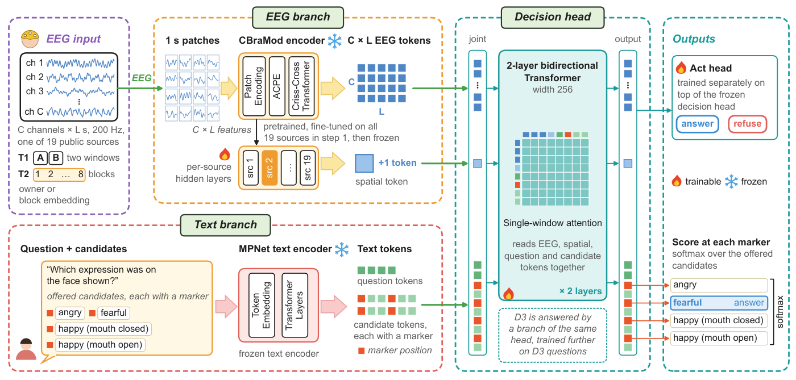
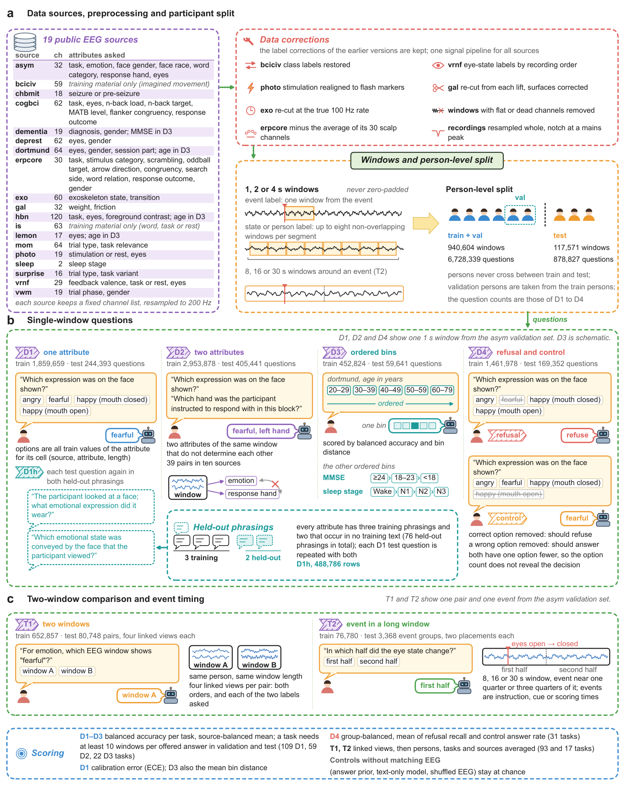
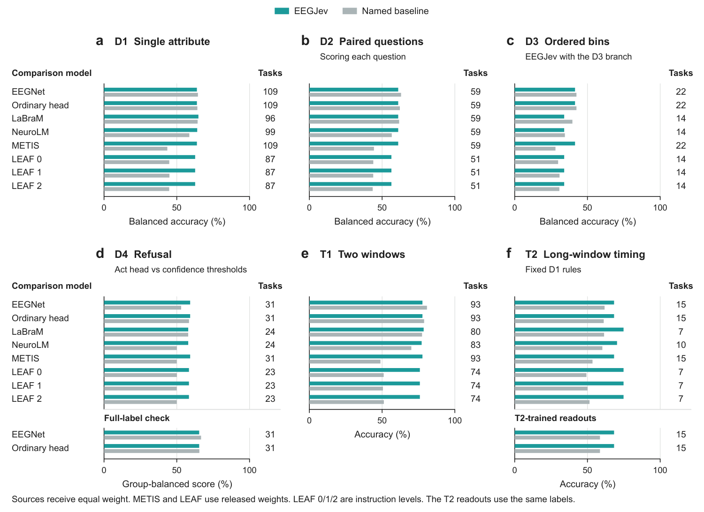

# EEGJev

### A System One Decision Model and Benchmark for Multi-Task EEG Question Answering

**19 public EEG sources &nbsp;·&nbsp; 17 scored sources &nbsp;·&nbsp; 6 question types**

[Overview](#overview) · [Benchmark](#benchmark) · [Results](#results) · [Quick start](#quick-start) · [Reproducibility](#reproducibility-and-source-terms) · [Contribute](CONTRIBUTING.md) · [Cite](CITATION.bib)

  
   <b>EEGJev architecture (paper Fig. 1).</b> A shared decision head scores the offered answers from EEG and text representations.

## Overview

**The question specifies what to read from the EEG.** EEGJev scores the offered answers in one pass through a shared decision head. EEGJev-Bench evaluates how decoders respond when the question, time span, or set of valid answers changes.

- **Question-guided decisions.** The decision head combines features from a CBraMod EEG encoder with frozen MPNet representations of the question and candidates.
- **Matched questions.** Paired-attribute questions keep the EEG and candidates fixed while asking about different attributes. Refusal questions also have answerable controls.
- **Temporal decisions.** The model can compare two windows or locate an event within a longer window by reading multiple EEG blocks.
- **Held-out participants.** Training, validation, and test are split by person for the scored sources. Results average across sources with equal weight.

## Benchmark

EEGJev-Bench covers six question types across 19 public EEG sources. Seventeen sources contribute to the test scores.

| Type | What the model decides | Scored tasks |
| :--- | :--- | ---: |
| D1 | Which value describes a single attribute? | 109 |
| D2 | What are the answers to two questions about the same window? | 59 |
| D3 | Which ordered bin contains the target? | 22 |
| D4 | Do the offered options include a valid answer? | 31 |
| T1 | Which of two windows matches the question? | 93 |
| T2 | When did an event occur within a longer window? | 17 |

  
   <b>Benchmark design (paper Fig. 2).</b> Data construction, question formats, and scoring.

<b>Evaluation framework</b>

**Scoring.** D1 and D3 report balanced accuracy. D2 reports balanced accuracy per answer and a joint score for getting both answers right. D4 balances answerable and refusal cases within matched groups. T1 and T2 report accuracy. D3 also reports mean bin distance.

**Aggregation.** The comparison for each pair of models uses the tasks both models cover. Scores give each contributing source equal weight.

## Results

  
   <b>Cross-model scores (paper Fig. 4).</b> Each comparison shows its task coverage.

The matched scores keep the model, question type, and task count alongside each result. Fixed-weight and trained model results retain their original evaluation protocols.

[Matched model comparisons](paper/v1.3/source-data/figure-4-matched-scores.csv) · [Source and seed results](paper/v1.3/source-data/fixed-options-by-source.csv) · [Supplementary resources](paper/v1.3/README.md)

## Quick start

Run a synthetic benchmark example with Python 3.13 and NumPy. It scores hand-written T1 and T2 answers and needs no EEG data or model weights.

~~~sh
python3.13 -m venv .venv
. .venv/bin/activate
python -m pip install numpy==2.4.3
python -I -B bench/examples/score_linked_demo.py
~~~

The example returns T1 at 0.50 and T2 at 1.00. See [the benchmark guide](bench/README.md) for the scoring inputs and [the model guide](model/README.md) to run the trained model with local weights.

## Contribute

[Report a benchmark correction](https://github.com/dengzhe-hou/EEGJev/issues/new?template=benchmark-correction.yml) · [Propose a question paradigm](https://github.com/dengzhe-hou/EEGJev/issues/new?template=new-question-paradigm.yml) · [Contribution guide](CONTRIBUTING.md)

## Reproducibility and source terms

| Path | Contents |
| :--- | :--- |
| [model/](model/README.md) | EEGJev CPU inference for the shared checkpoint |
| [bench/](bench/README.md) | v1.3 corpus reader and a T1/T2 scoring example |
| [paper/v1.3/](paper/v1.3/README.md) | Aggregate results, supplementary comparisons and figure reproduction |

From the repository root, reproduce the fixed-option panel from its aggregate source means.

~~~sh
python -m pip install matplotlib==3.10.8
python -I -B paper/v1.3/figures/reproduce_fig3a.py figure3a-output
~~~

The [model repository](https://huggingface.co/dengzhe-hou/EEGJev) and the [benchmark dataset repository](https://huggingface.co/datasets/dengzhe-hou/EEGJev-Bench) describe access to the associated artifacts. Source EEG datasets retain their own terms. The bundled [CBraMod code](model/eegjev/cbramod/LICENSE) and [Liberation Sans fonts](paper/v1.3/figures/fonts/LICENSE) retain their upstream licenses.

---

[Project website](https://dengzhe-hou.github.io/EEGJev/)
